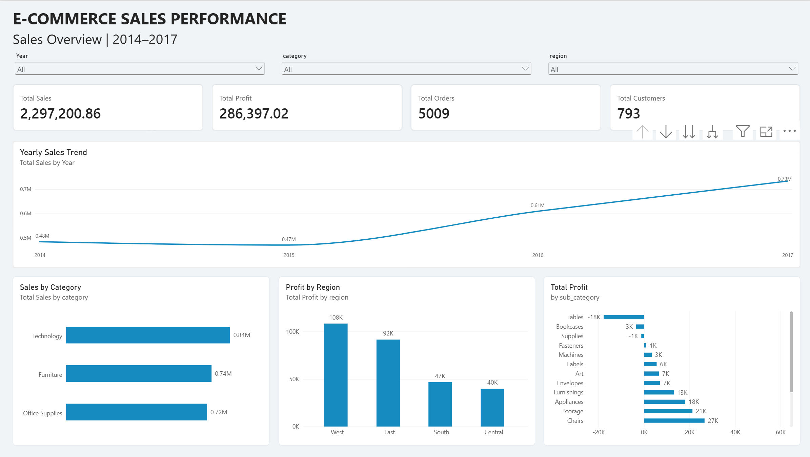

# E-Commerce Sales Performance Analysis

## Project Overview

This project analyzes the Sample Superstore dataset to evaluate sales performance, profitability, customer activity, and regional performance.

The objective is to identify business trends, discover areas of low profitability, and provide data-driven business recommendations.

## Tools & Technologies

- PostgreSQL
- SQL
- Microsoft Power BI
- Microsoft Excel

## Dataset

Sample Superstore Dataset

Source: [Kaggle - Sample Superstore Dataset](https://www.kaggle.com/datasets/vivek468/superstore-dataset-final)

- Total Records: 9,994
- Period: 2014–2017

## Key Performance Indicators

| Metric | Result |
|---|---:|
| Total Sales | $2,297,200.86 |
| Total Profit | $286,397.02 |
| Total Orders | 5,009 |
| Total Customers | 793 |

## Dashboard Preview

## Key Business Insights

1. Technology generated the highest sales and profit among the three product categories.
2. Furniture had relatively low profitability, with a profit margin of approximately 2.49%.
3. The West region generated the highest sales and profit.
4. The Central region had a relatively low profit margin of approximately 7.92%.
5. The Tables sub-category recorded a significant overall loss.

## Business Recommendations

- Maintain the strong performance of the Technology category.
- Evaluate Furniture pricing and discount strategies.
- Review sales strategies in the Central region.
- Investigate costs, pricing, and discount policies for loss-making products.

## Project Structure

- `dataset/`: Dataset information and source.
- `sql/`: SQL queries used for analysis.
- `powerbi/`: Power BI dashboard.
- `images/`: Dashboard screenshots.

## Conclusion

This project demonstrates the use of SQL, PostgreSQL, and Power BI to transform raw retail transaction data into meaningful business insights and actionable recommendations.
